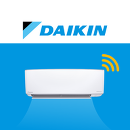

<p align="center"></p>

# GO DAIKIN Local

[](https://github.com/smurmann/godaikin-local/actions/workflows/validate.yml)
[](https://hacs.xyz)

Cloud-free Home Assistant integration for Daikin air conditioners that are normally driven by
the **GO DAIKIN** app (Daikin Malaysia, Singapore and Indonesia; package `my.com.daikin.app`).

Home Assistant talks to the unit over your LAN using the same protocol the app uses when the
phone is at home: UDP discovery on port 61244 and an AES-encrypted JSON channel on TCP 7002.
The cloud is contacted exactly once, during setup, to obtain the per-unit key.
[docs/PROTOCOL.md](docs/PROTOCOL.md) documents how the protocol was recovered from the app and
which behaviour has been verified on real units.

The integration follows Home Assistant's
[integration quality scale](https://developers.home-assistant.io/docs/core/integration-quality-scale/);
the rule-by-rule status is in [`quality_scale.yaml`](custom_components/godaikin_local/quality_scale.yaml).

## Supported devices

| Works | Notes |
|---|---|
| ✅ Daikin split units paired with the GO DAIKIN app via the Daikin Wi‑Fi adapter (module MAC prefixes `38:E7:C0`, `A8:16:9D`), adapter firmware V1.2.x | Verified on two units |
| ✅ 3‑speed and 5‑speed handset variants | 5‑speed table is taken from the app; not yet seen on hardware |
| ❌ Daikin purifiers / humidifiers in the same app ("GPF" units) | Different, unauthenticated HTTP protocol; see PROTOCOL.md §5 |
| ❌ Daikin units from other regions (Onecta, Daikin Smart AC, BRP069/BRP072 adapters) | Different apps and protocols; use the core `daikin` integration or Faikin |

## Use cases

- Control and automate the aircon from Home Assistant with no internet dependency and no
  Google/Alexa relay.
- Put the aircon on a schedule, link it to presence, door/window sensors or a room thermostat
  (see examples below).
- Keep working during ISP outages or if Daikin retires the cloud service.

## Supported functionality

| Entity | What it does |
|---|---|
| `climate` | Off / cool / dry / fan only / heat / auto, target temperature 16–30 °C in 1 °C steps, fan (`auto`, `low`, `medium`, `high`, plus `medium_low` / `medium_high` on 5‑speed units), swing (`off` / `vertical`), presets (`boost` = turbo, `silent`, `sleep`) |
| `select` Louver position | Fixed vertical louver positions 1–5, off, or swing |
| `switch` Ioniser | The unit's ioniser / streamer |
| `sensor` Firmware version | Adapter firmware (diagnostic) |
| `sensor` Room / outdoor temperature, humidity, power, error code | Created only when the unit reports the field locally (adapter firmware V1.2.3 does not) |
| Cloud sensors (opt-in) | Room, coil, outdoor and discharge temperatures, humidity, power, compressor frequency/runtime/state, DC bus voltage, error code, cloud connectivity, presence |

Each config entry is one unit and one device. Built-in behaviours: DHCP discovery of new units,
re-authentication when a key is rejected, reconfiguration of the address or name, diagnostics
download with the key redacted.

## Installation

### Prerequisites

- The unit is paired in the GO DAIKIN app and connected to your Wi‑Fi.
- Home Assistant can reach the unit's IP on TCP port 7002 (same network, or routed between VLANs).
- Give the unit a DHCP reservation; the integration addresses it by IP.

### HACS (recommended)

1. HACS → Integrations → ⋮ → *Custom repositories* → add `https://github.com/smurmann/godaikin-local`, category *Integration*.
2. Install **GO DAIKIN Local** and restart Home Assistant.

### Manual

Copy `custom_components/godaikin_local` into your `config/custom_components/` and restart.

## Setup

Home Assistant discovers units automatically when they obtain a DHCP lease and shows them under
*Settings → Devices & services → Discovered*. Otherwise choose *Add integration → GO DAIKIN Local*.

Installation parameters:

| Parameter | Meaning |
|---|---|
| Email / Password | Your GO DAIKIN app login. Used once to fetch the unit key; not stored. |
| Unit | Which unit on the account to add (units already configured are hidden). |
| IP address | Address of the unit; pre-filled when discovery reached it. |
| Name | Display name, for example the room. |
| TCP port | 7002 unless you know otherwise. |
| Force 5‑speed fan table | Normally auto-detected; only tick it if a 5‑speed unit shows three speeds. |

The *Enter unit key manually* path takes the IP, the thing name (`Daikin_<mac>`) and the
32‑character hex key instead; `tools/fetch_unit_keys.py` prints both for every unit on an account.

Use *Reconfigure* on the entry to change address, port or name.

### Options (Configure)

The feature set is detected from your GO DAIKIN account at setup (the cloud shadow carries
`Bar_*`/`Ena_*`/`Inf_*` flags; the local status does not). *Configure* on the entry lets you override it:

| Option | Meaning | Default |
|---|---|---|
| Cloud sensors | Opt-in cloud polling for sensor values (see *Cloud sensors*) | Off |
| Cloud poll interval | 5–120 minutes | 10 |
| Modes the unit supports | Which of cool, dry, fan, heat, auto the climate entity offers | Detected; cool + dry + fan for entries without detection |
| Presets the unit supports | boost (Turbo), silent, sleep | Detected from `Ena_Turbo`, `Ena_Silent`, `Bar_Sleep` |
| Fan speed steps | 3 or 5 | Detected from the handset type (`Inf_IDAlgo`) |
| Vertical swing | Whether swing is offered | Detected from `Bar_Swing` |

Cooling-only units (common in Malaysia and Singapore) have no heat or auto mode; selecting one
would be silently ignored by the unit, so those modes are hidden.

## Cloud sensors (optional)

The local channel exposes only the control state. The unit reports its sensors to Daikin's
cloud, and you can opt in to reading them: *Configure → Cloud sensors*. Home Assistant then
adds room, indoor-coil, outdoor, outdoor-coil and discharge temperatures, humidity, power,
compressor frequency and runtime, DC bus voltage, error code, a compressor-running binary
sensor, a cloud-connectivity binary sensor and presence (on models with a sensor). The climate
card also shows the room temperature. Control still never leaves your LAN.

How it is kept safe and cheap:

- Enabling asks for your GO DAIKIN login **once**. Only the resulting refresh token and the
  account's subject ID are stored, never the password. Tokens are renewed with the refresh
  token the same way the app does; if Daikin revokes it, Home Assistant prompts you to sign in
  again. Changing your password in the app revokes it immediately.
- One cloud request returns every unit on the account, so entries on the same account share a
  single poll and a single session. Default interval 10 minutes, minimum 5: at most 288
  requests a day for the whole account, well under what the app itself generates.
- A cloud outage only makes the cloud sensors unavailable; local control keeps working.

## Data updates

The integration polls each unit every 30 seconds over TCP (the app polls every second; 30 s is
plenty for an aircon and gentle on the adapter). Commands are sent immediately and the entity
state is updated optimistically, then confirmed by the next poll. There is no push channel.
Cloud sensors, when enabled, are read every 10 minutes by default (see above).

## Automation examples

Turn the unit off when a window stays open:

```yaml
automation:
  - alias: "Office: AC off when window open"
    triggers:
      - trigger: state
        entity_id: binary_sensor.office_window
        to: "on"
        for: "00:05:00"
    actions:
      - action: climate.turn_off
        target:
          entity_id: climate.office_ac
```

Cool the office before work on weekdays, quietly:

```yaml
automation:
  - alias: "Office: pre-cool"
    triggers:
      - trigger: time
        at: "08:30:00"
    conditions:
      - condition: time
        weekday: [mon, tue, wed, thu, fri]
    actions:
      - action: climate.set_hvac_mode
        target: { entity_id: climate.office_ac }
        data: { hvac_mode: cool }
      - action: climate.set_temperature
        target: { entity_id: climate.office_ac }
        data: { temperature: 24 }
      - action: climate.set_preset_mode
        target: { entity_id: climate.office_ac }
        data: { preset_mode: silent }
```

## Known limitations

- Adapter firmware V1.2.3 does not expose room temperature, humidity or power locally. Enable
  *Cloud sensors* to get them from Daikin's cloud, or pair the climate card with a room sensor.
- UDP discovery is a broadcast and does not cross VLANs; DHCP discovery needs Home Assistant to
  see the unit's DHCP traffic. Entering the IP by hand always works.
- One account login per unit during setup (Home Assistant creates one config entry per flow).
- The 5‑speed fan mapping and heat mode come from the app's code and have not been exercised on
  hardware yet.

## Troubleshooting

| Symptom | What to check |
|---|---|
| *Could not connect* during setup | Is the IP right and the unit on? Can Home Assistant reach TCP 7002 (firewall / VLAN rules)? `python3 tools/godaikin_cli.py ping --host <ip>` should print `<{"ack":2}>`. |
| *Reply could not be decrypted* / entity asks to re-authenticate | The unit's key changed (re-pairing in the app issues a new one). Complete the re-authentication prompt. |
| Entities `unavailable` | The unit stopped answering; the log shows one message when it goes away and one when it returns. Check Wi‑Fi on the unit. |
| Discovery finds nothing | Expected across VLANs. Use *Add integration* and enter the IP. |
| Commands fail with *Command to the GO DAIKIN unit … failed* | Network issue mid-command; the error carries the host and reason. |

Enable debug logging with:

```yaml
logger:
  logs:
    custom_components.godaikin_local: debug
```

## Removal

Delete the integration entry under *Settings → Devices & services → GO DAIKIN Local*. Nothing
is left on the unit or in the cloud; the unit keeps working with the app. To remove the code,
uninstall it in HACS (or delete `custom_components/godaikin_local`) and restart.

## Command-line tools

```bash
python3 tools/test_protocol.py                       # offline protocol tests
python3 tools/godaikin_cli.py discover               # UDP broadcast on this network
python3 tools/godaikin_cli.py --targets 192.168.20.7,192.168.20.8 discover   # units on another VLAN
python3 tools/fetch_unit_keys.py                     # keys from your account (prompts; --save to store)
export GODAIKIN_KEY=<32 hex chars>
python3 tools/godaikin_cli.py status --host 192.168.x.y --thing <thingName>
python3 tools/godaikin_cli.py set    --host 192.168.x.y --thing <thingName> Set_OnOff=1 Set_Mode=1 Set_Temp=24
```

The tools need only the Python standard library plus `cryptography`.

## Security notes

Anyone on your LAN who holds a unit's key can control that unit. Treat keys like passwords.
Diagnostics downloads redact them.

## Brand assets

The integration ships its own icon and logo in `custom_components/godaikin_local/brand/`, which Home Assistant 2026.3 and newer serve locally (the central brands repository no longer accepts custom integrations). Home Assistant 2025.1 or newer is required by the integration itself; versions before 2026.3 simply show a generic icon.

## Development

```bash
uv sync --group dev
uv run ruff check . && uv run ruff format --check .
uv run mypy                      # strict
uv run python tools/test_protocol.py
uv run pytest                    # Home Assistant test harness, ≥95% coverage enforced
```

CI runs hassfest, the HACS validator, ruff, mypy and the test suite on every push.
